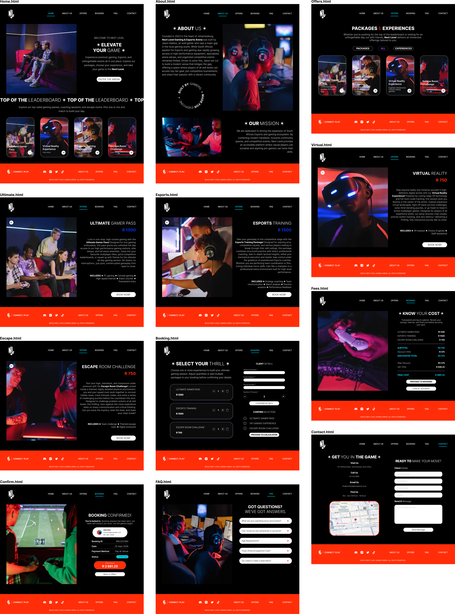
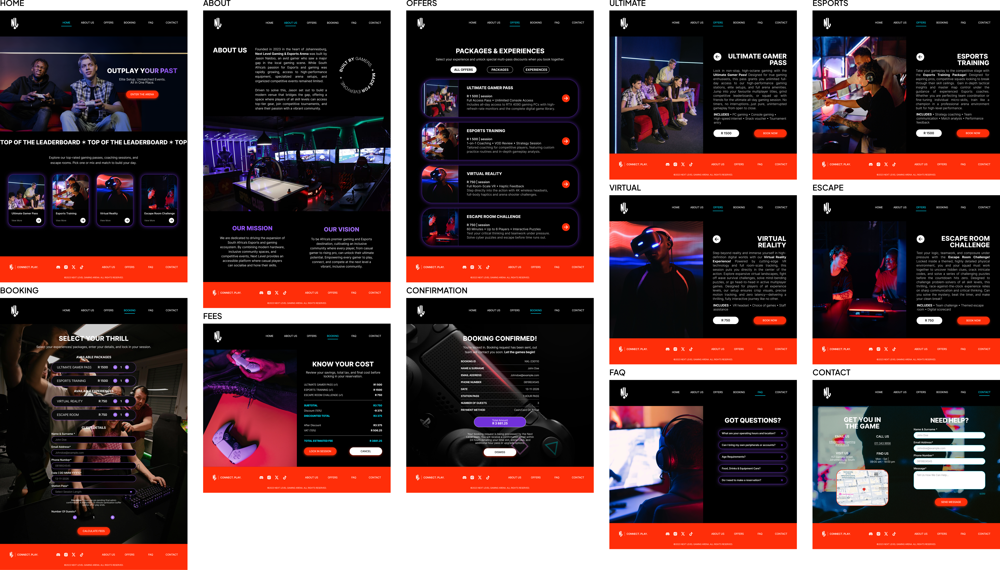

# NEXT LEVEL GAMING ARENA | WEBSITE DESIGN CHANGELOG
## From Task 2 Initial Wireframes to Final Website UI Design & Development

### SUMMARY OF MAJOR DESIGN CHANGES

- Home / Hero: Content restructuring and visual refinement.
- About Us: Layout and visual hierarchy redesign.
- Packages & Experiences: Navigation tabs and card structure enhancement.
- Service Pages (Ultimate Gamer Pass, Esports Training, Virtual Reality, Escape Room Challenge): Content alignment and call-to-action refinement.
- Booking & Service Selection: Transition from app-style flow to desktop-optimized multi-column layout.
- Cost & Fees Breakdown: Enhanced transparency and summary placement.
- Booking Confirmation: Improved desktop layout and data arrangement.
- FAQ: Section layout and expandable card refinement.
- Contact & Location: Redesigned multi-column contact form and interactive map integration.
- Navigation Header / Footer: Desktop-specific top navigation bar and comprehensive footer links.

### 1. OVERALL DESIGN DEVELOPMENT

The initial wireframes (`WEBSITE WIREFRAMES TASK 2`) established the desktop structure, layout placement, and navigation hierarchy. 

The final website UI design (`WEBSITE WIREFRAMES FINAL`) builds upon this foundation by refining visual elements, enhancing content spacing, optimizing desktop form layouts, and introducing high-impact imagery to create a more polished, professional, and immersive gaming arena website.

### 2. GLOBAL DESIGN AND VISUAL CHANGES

- **Desktop-Optimized Layouts:** Shifted from mobile/app-style stacked screens to wide-format, multi-column desktop sections.
- **Header Navigation:** Established a clean top navigation bar across all pages featuring logo placement and direct links (Home, About Us, Offers, Booking, FAQ, Contact).
- **Footer Integration:** Standardised a feature-rich dark footer across the site with social links, quick navigation, and contact details.
- **Visual Consistency:** Maintained the signature dark gaming aesthetic accented by vibrant purple, blue, and orange/red call-to-action highlights.
- **Typography & Contrast:** Improved text hierarchy, font weights, and contrast against dark backgrounds and atmospheric gaming photography.

### 3. SCREEN-BY-SCREEN CHANGELOG

#### 3.1 HOME

##### Changes:
- Replaced the primary headline to focus on high-impact gaming messaging.
- Enhanced the hero section with prominent action buttons.
- Refined the presentation of featured leaderboard thumbnails and top-tier offerings.
- Improved grid alignment for content previews across the homepage sections.

##### Reason:
- To capture user attention immediately and provide a clear entry point into the arena's offerings.

#### 3.2 ABOUT US

##### Changes:
- Transitioned from a simple text block to structured side-by-side cards highlighting "Our Mission" and "Our Vision".
- Integrated high-quality interior photography of the gaming lounge.
- Refined the "Built by Gamers, Made for Everyone" brand stamp layout.

##### Reason:
- To communicate company values and showcase the physical venue environment more effectively.

#### 3.3 PACKAGES & EXPERIENCES

##### Changes:
- Introduced a clear category filter bar at the top (All Items, Packages, Experiences).
- Redesigned package cards with a sleek, dark translucent container style and high-contrast pricing indicators.
- Standardised the interactive action buttons for browsing individual services.

##### Reason:
- To make it easier for visitors to filter, browse, and compare available gaming options.

#### 3.4 INDIVIDUAL SERVICE PAGES (Ultimate Gamer Pass, Esports Training, Virtual Reality, Escape Room Challenge)

##### Changes:
- Structured each service into a dedicated desktop layout featuring immersive imagery and detailed "Includes" feature lists.
- Prominently positioned pricing (e.g., R1,500, R750) next to service headers.
- Standardised "Book Now" buttons across all experience pages.

##### Reason:
- To provide thorough service details while maintaining a consistent visual template across all offerings.

#### 3.5 BOOKING & SERVICE SELECTION

##### Changes:
- Adapted the booking form into a clean desktop layout with side-by-side service selection ("Select Your Thrill") and client detail inputs.
- Incorporated explicit quantity selectors and clear pricing tags for each package/experience.
- Grouped client information fields (Name, Surname, Email, Phone, Date, Time, Guests) into a structured form layout.

##### Reason:
- To streamline the desktop reservation workflow, enabling users to configure selections and input details on a single comprehensive interface.

#### 3.6 FEES

##### Changes:
- Created a dedicated, highly structured cost summary panel ("Know Your Cost").
- Clearly itemized subtotal, discount, discounted total, VAT, and final payable amount.
- Positioned "Lock in Session" and "Cancel" actions prominently below the breakdown.

##### Reason:
- To ensure absolute pricing transparency before users commit to payment.

#### 3.7 BOOKING CONFIRMATION

##### Changes:
- Designed a clear receipt-style layout headed by "Booking Confirmed!".
- Organized booking credentials (Booking ID, Date/Time, Guest Count, Payment Method) into clean data rows.
- Highlighted total payment figures and status badges.

##### Reason:
- To provide clear confirmation and peace of mind upon transaction completion.

#### 3.8 FAQ

##### Changes:
- Refined the expandable accordion question-and-answer layout ("Got Questions?").
- Improved spacing and typography for easy scanning of common customer inquiries.

##### Reason:
- To reduce friction by answering common visitor questions without requiring direct support contact.

#### 3.9 CONTACT & LOCATION

##### Changes:
- Replaced basic contact lists with a split desktop view featuring a detailed location map ("Get You in the Game") alongside an interactive contact form ("Need Help?").
- Structured business details, operating hours, and location markers clearly.

##### Reason:
- To make location discovery and customer inquiries as effortless as possible for website visitors.

### 4. NAVIGATION AND USER JOURNEY IMPROVEMENTS

The final website design establishes a logical desktop user journey:

1. **Home:** Users land on an engaging visual introduction to the gaming arena.
2. **About Us:** Visitors learn about the facility, mission, and vision.
3. **Offers:** Users filter and explore available gaming passes and experiences.
4. **Booking & Fees:** Users select packages, input guest/date details, and review an itemized cost breakdown.
5. **Confirmation:** Users receive a verified booking summary.
6. **Contact:** Users access FAQs or submit direct inquiries with map assistance.

### 5. USABILITY AND USER EXPERIENCE IMPROVEMENTS

- **Desktop Form Factor Optimization:** Replaced cramped mobile layouts with spacious multi-column desktop grids.
- **Enhanced Pricing Transparency:** Clear subtotal, discount, and VAT calculations displayed prior to confirmation.
- **Streamlined Service Discovery:** Category filtering allows quick navigation between general packages and specialized experiences.
- **Strong Brand Consistency:** Deep dark mode styling combined with vibrant neon accents reinforces the Next Level Gaming Arena identity.

### 6. FINAL OUTCOME

The final website UI design successfully translates the core features of the brand into a fully responsive, desktop-optimized web experience. It delivers improved service presentation, seamless booking and cost review workflows, and a professional interface that elevates the online presence of Next Level Gaming Arena.