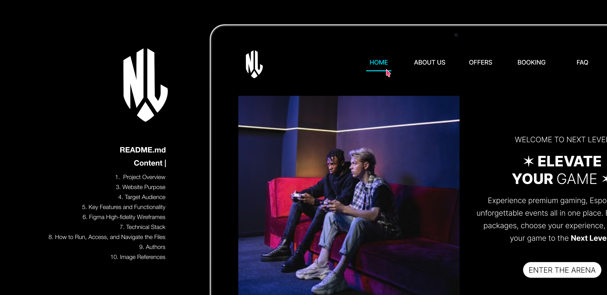

# Welcome to the **NEXT LEVEL GAMING ARENA** Website

[✦ YOUTUBE VIDEO LINK ✦](https://youtu.be/Z1DuGEvNvk8?si=75ISm0o_flsh9m6-)

REMEMBER TO INCREASE THE VIDEO QUALITY ON YOUTUBE TO 1080DP

**Note:** This repository represents the early structural phase of the Next Level Gaming & Esports Arena web platform. The site currently consists of pure, semantic HTML5 static files establishing the content, navigation hierarchy, and layout structure across all pages. Visual styling (CSS) and dynamic client-side interactivity (JavaScript/TypeScript), such as real-time fee calculations—will be integrated in upcoming development stages.

## 1. Project Overview

### Mission
We are dedicated to driving the expansion of South Africa’s Esports and gaming ecosystem. By combining modern hardware, inclusive community spaces, and competitive events, Next Level provides an accessible platform where casual players can socialise and aspiring pro-gamers can hone their skills.

### Vision
To become South Africa's premier gaming center and community hub, setting the standard for local esports events, high-performance gaming experiences, and interactive community engagement.

## 2. Website Purpose
The Next Level Gaming Arena website connects gamers directly with our physical venue in Johannesburg and online booking services. The application allows users to explore available packages and experiences (Ultimate Gamer Pass, Esports Training, Virtual Reality, Escape Room Challenge), select custom quantities, calculate discounted totals with transparent fee summaries, confirm bookings, review FAQs, and contact venue management directly.

## 3. Target Audience
- **Casual Gamers ✶** Individuals looking for high-end setups, console lounges, and VR experiences to play with friends.
- **Competitive Esports Players & Teams ✶** Gamers seeking high-refresh-rate rigs, structured training sessions, and professional coaching.
- **Event Organizers & Party Hosts ✶** Users looking to book group packages, escape room challenges, or private venue experiences.
- **Gaming Communities ✶** Streamers and local gaming enthusiasts looking for high-speed internet and dedicated gaming stations.

## 4. Key Features and Functionality

### Home Page (`home.html`)
- **Brand Hero Header:** Prominent branding, primary tagline ("CONNECT. PLAY"), and immediate primary navigation links.
- **Core Value Highlights:** High-impact introduction showcasing the arena's atmosphere, gaming gear, and community environment.
- **Quick Links:** Seamless pathways to explore pricing packages, book a gaming session, or view location details.

### About Us (`about.html`)
- **Arena Background & History:** Full overview of Next Level's founding, values, and role within South Africa's gaming sector.
- **Venue Specifications:** Details regarding high-end PC specs, console stations, fiber optic network capabilities, and ergonomic gaming setups.
- **Community Focus:** Highlights of weekly local tournaments, casual meetups, and inclusive venue environment.

### Offers (`offers.html`)
- **Experience Package Listings:** Comprehensive showcases for all four core offerings:
  - *Ultimate Gamer Pass* (R1500)
  - *Esports Training* (R1500)
  - *Virtual Reality Experience* (R750)
  - *Escape Room Challenge* (R750)
- **Dedicated Sub-pages:** Dedicated detailed pages for deep dives into individual experiences (`ultimate.html`, `esports.html`, `virtual.html`, `escape.html`).
- **Internal Anchor Navigation:** Quick-scroll links enabling instant navigation between specific experience sections.

### Bookings & Calculation (`booking.html` & `fees.html`)
- **Interactive Package Selector (`booking.html`):** Custom checkbox and quantity selectors for adding multiple experiences to a single booking session.
- **Guest Info Form:** Standardized input fields for customer full name, email address, phone number, and guest count.
- **Transparent Fee Summary (`fees.html`):** Static template structured to display subtotal, multi-tier discount application, 15% South African VAT calculation, and final total:
  - *1 Booking:* 0% discount
  - *2 Bookings:* 5% discount
  - *3 Bookings:* 10% discount
  - *>3 Bookings:* 15% discount

### FAQs & Support (`faq.html`)
- **Interactive Accordion UI:** Native HTML `
` and `
` elements providing collapsible, clutter-free Q&A sections.
- **Essential Operational Guidelines:** Direct answers regarding venue location, business operating hours (Mon–Sat 09:00–18:00, closed Sundays), age restrictions (under 12 guardian requirements), BYO peripheral/account policies, and hardware care rules.

### Contact Us (`contact.html`)
- **Direct Venue Info:** Physical address (Braamfontein, Johannesburg), contact phone numbers, operating hours, and official email links.
- **Embedded Interactive Map:** Integrated Google Maps `<iframe>` pin point showing exact venue coordinates at 41 Juta St, Braamfontein.
- **Client Inquiry Form:** Form fields allowing users to send direct messages, feedback, or booking inquiries to venue management.

## 5. Figma High-fidelity Wireframes

## 6. Technical Stack

### Core Technologies
- **HTML5 |** Semantic markup structure providing accessibility, native form handling, dynamic `
` dropdowns, and SEO optimization.
- **CSS3 (Planned) |** Custom styling engine for implementing dark-mode gaming aesthetics, custom color accents, and responsive layout grids.
- **JavaScript / TypeScript (Planned) |** Client-side scripting engine to manage dynamic cart states, state persistence across pages (`localStorage`), and automated fee calculation logic.

### External Assets
- **Google Maps Embed API |** Embedded geolocation map iframe for physical venue location rendering.
- **Custom Graphics & Media |** High-fidelity photography assets, custom vector star decorative symbols ("✦" / "✶"), and official brand logos.

### Developer Tools & Version Control
- **Git |** Distributed version control system for tracking incremental changes and page updates.
- **GitHub |** Cloud-based repository hosting and changelog tracking via Conventional Commits.
- **Visual Studio Code |** Primary IDE equipped with Live Server for local cross-page navigation testing.

## 8. How to Run, Access, and Navigate the Files
### Running the Website Locally
**A. Clone the Repository:**
- git clone [https://github.com/Lethabomohlala/Next-Level-Gaming-Arena-Website.git](https://github.com/Lethabomohlala/Next-Level-Gaming-Arena-Website.git)

**B. Open the Project Directory:**- cd next-level-web

**C. Launch in Browser:**
- Option A (VS Code Live Server - Recommended): Open the project folder in Visual Studio Code, right-click home.html, and select "Open with Live Server".
- Option B (Direct Open): Double-click any .html file (e.g., home.html) directly from your file manager to open it in your preferred web browser.

**D. Project File Structure & Navigation**

next-level-web/
├── images/           # Brand logos, icons, high-res banners, and wireframes
├── home.html         # Landing page / Hero showcase & brand introduction
├── about.html        # Brand story, mission, vision, and hardware specs
├── offers.html       # Experience package showcase with internal anchor links
├── ultimate.html     # Dedicated experience page: Ultimate Gamer Pass
├── esports.html      # Dedicated experience page: Esports Training
├── virtual.html      # Dedicated experience page: Virtual Reality Experience
├── escape.html       # Dedicated experience page: Escape Room Challenge
├── booking.html      # Interactive experience selector and client details form
├── fees.html         # Cost breakdown, tiered discount, and VAT calculation layout
├── confirm.html      # Booking confirmation page with summary details
├── faq.html          # Interactive accordion FAQ page
├── contact.html      # Venue location details, contact form, and Google Maps embed
└── README.md         # Project documentation

**E. Making Changes and Pushing Updates:**
To update code or content via VS Code Terminal:
- Edit target files: Save changes in your .html files.
- Stage changes | git add .
- Commit with detailed message | git commit -m “short description" -m "- Detailed line 1
Detailed line 2.”
- Push to remote repository | git push origin main

## 9. Authors

- **Lethabo Mohlala**
- **Keabestswe Mathole**
- **Kevin Siaga**

### Copyright

© 2026 Group 6. All rights reserved.

This project and its source code are intended for educational and project purposes. Unauthorized copying, redistribution, or commercial use of this project is not permitted without permission from Lethabo Mohlala, Keabestswe Mathole and Kevin Siaga.

## 10. Image References

Darmel, A. *[s.a.]*. *A boy and girl playing games.* [Online image]. Pexels. Available at: https://www.pexels.com/photo/a-boy-and-girl-playing-games-7862384/ [Accessed: 06 October 2026].

Darmel, A. *[s.a.]*. *A person holding a wireless game controller.* [Online image]. Pexels. Available at: https://www.pexels.com/photo/a-person-holding-a-wireless-game-controller-7862390/ [Accessed: 06 October 2026].

Darmel, A. *[s.a.]*. *Group of friends playing a video game.* [Online image]. Pexels. Available at: https://www.pexels.com/photo/group-of-friends-playing-a-video-game-7862405/ [Accessed: 06 October 2026].

Darmel, A. *[s.a.]*. *Men sitting on the couch while playing video games.* [Online image]. Pexels. Available at: https://www.pexels.com/photo/men-sitting-on-the-couch-while-playing-video-games-7862272/ [Accessed: 06 October 2026].

Krukau, Y. *[s.a.]*. *A team playing online games.* [Online image]. Pexels. Available at: https://www.pexels.com/photo/a-team-playing-online-games-9072248/ [Accessed: 06 October 2026].

Krukau, Y. *[s.a.]*. *Men in a computer shop.* [Online image]. Pexels. Available at: https://www.pexels.com/photo/men-in-a-computer-shop-9072326/ [Accessed: 06 October 2026].

Krukau, Y. *[s.a.]*. *Men playing computer games.* [Online image]. Pexels. Available at: https://www.pexels.com/photo/men-playing-computer-games-9072319/ [Accessed: 06 October 2026].

Krukau, Y. *[s.a.]*. *Men pointing on computer screen.* [Online image]. Pexels. Available at: https://www.pexels.com/photo/men-pointing-on-computer-screen-9072251/ [Accessed: 06 October 2026].

Krukau, Y. *[s.a.]*. *People using computers.* [Online image]. Pexels. Available at: https://www.pexels.com/photo/people-using-computers-9072392/ [Accessed: 06 October 2026].

Krukau, Y. *[s.a.]*. *Young men engaged in e-sports playing in a tournament.* [Online image]. Pexels. Available at: https://www.pexels.com/photo/young-men-engaged-in-e-sports-playing-in-a-tournament-9072328/ [Accessed: 06 October 2026].

SHVETS Production *[s.a.]*. *Portrait of a man using a virtual reality headset.* [Online image]. Pexels. Available at: https://www.pexels.com/photo/portrait-of-a-man-using-a-virtual-reality-headset-7562029/ [Accessed: 06 October 2026].