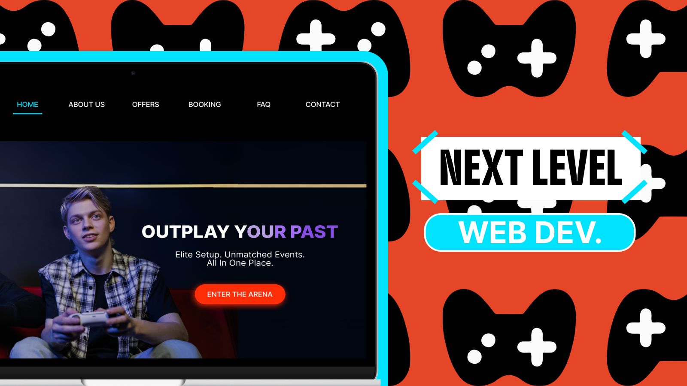
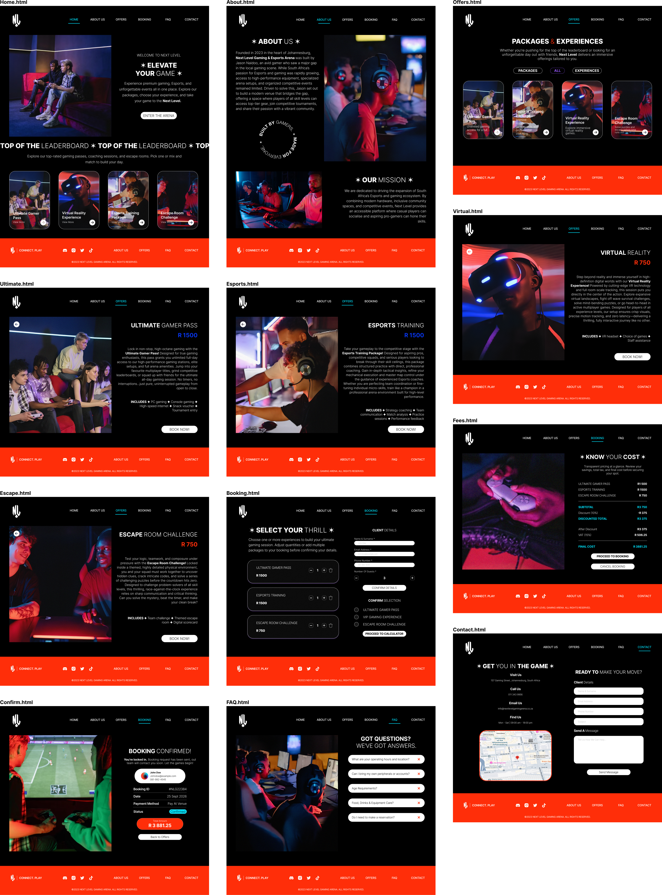
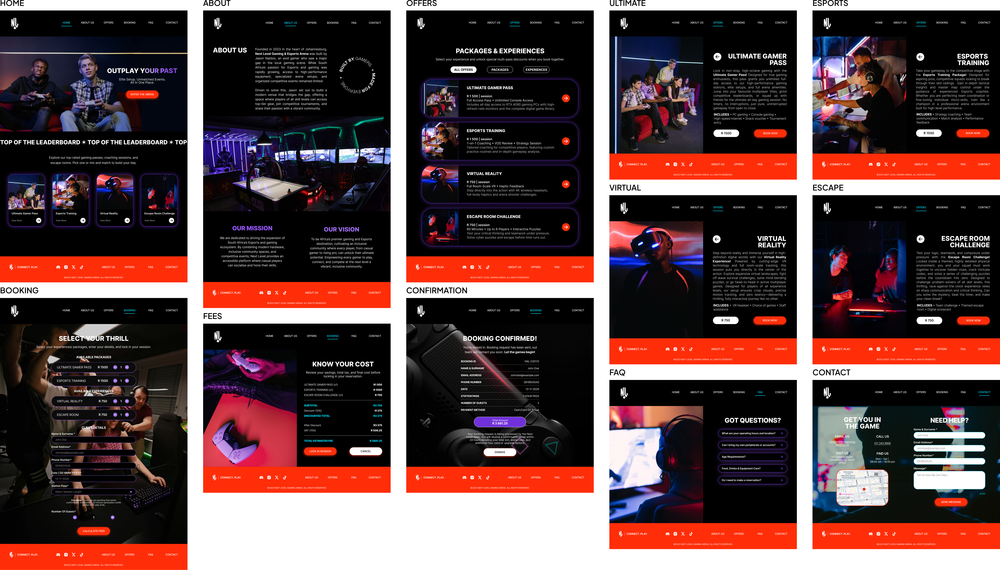
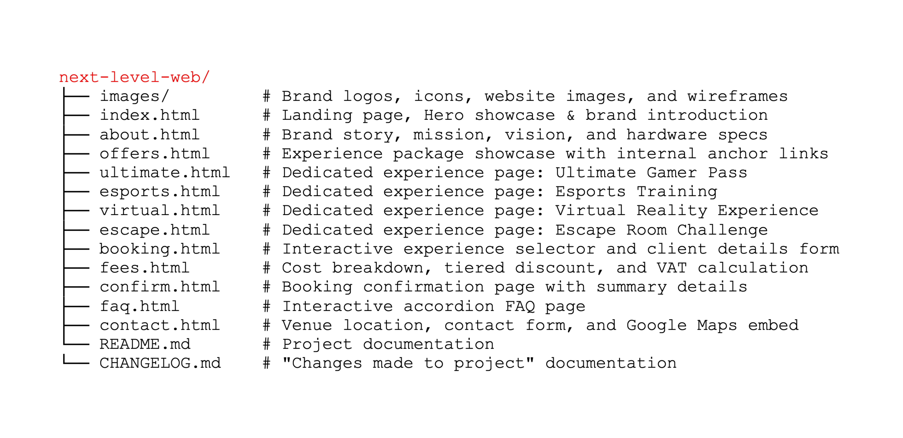

# NEXT LEVEL GAMING ARENA WEBSITE

[✦ YOUTUBE VIDEO LINK ✦](https://youtu.be/DlEvOrQe9y8)

**TIMESTAMP: 06:37 Website Walkthrough** | REMEMBER TO INCREASE THE VIDEO QUALITY ON YOUTUBE TO 1080DP. 

**Note:** This repository represents the completed, desktop-optimized UI design and front-end implementation of the Next Level Gaming & Esports Arena web platform. Building upon the initial structural wireframes, the site features a responsive dark-mode gaming aesthetic, multi-column desktop layouts, interactive filtering, and a complete reservation and cost-breakdown workflow.

## 1. Team Contributions & Roles

| Team Member           | Branch Name        | Primary Contributions & Responsibilities                                                                                                                                    |
| :-------------------- | :----------------- | :-------------------------------------------------------------------------------------------------------------------------------------------------------------------------- |
| **Lethabo Mohlala**   | `main` | Organized the final repository structure, resolved CSS issues, and refined the overall application design. |
| **Keabetswe Mathole** | `main`      | Built the initial HTML page structures, implemented form handling, and organized information structuring. |
| **Kevin Siaga**       | `main`   | Developed the core CSS and JavaScript, implementing overall application logic and input validations. |

## 2. Project Overview

### Mission
We are dedicated to driving the expansion of South Africa’s Esports and gaming ecosystem. By combining modern hardware, inclusive community spaces, and competitive events, Next Level provides an accessible platform where casual players can socialise and aspiring pro-gamers can hone their skills.

### Vision
To become South Africa's premier gaming center and community hub, setting the standard for local esports events, high-performance gaming experiences, and interactive community engagement.

## 3. Website Purpose
The Next Level Gaming Arena website connects gamers directly with our physical venue in Johannesburg and online booking services. The application allows users to explore and filter available packages and experiences (*Ultimate Gamer Pass*, *Esports Training*, *Virtual Reality*, *Escape Room Challenge*), select custom quantities, review itemized cost breakdowns with multi-tier discounts and VAT, receive verified booking confirmations, browse FAQs, and contact venue management via an interactive map and inquiry form.

## 4. Target Audience
- **Casual Gamers ✶** Individuals looking for high-end setups, console lounges, and VR experiences to play with friends.
- **Competitive Esports Players & Teams ✶** Gamers seeking high-refresh-rate rigs, structured training sessions, and professional coaching.
- **Event Organizers & Party Hosts ✶** Users looking to book group packages, escape room challenges, or private venue experiences.
- **Gaming Communities ✶** Streamers and local gaming enthusiasts looking for high-speed internet and dedicated gaming stations.

## 5. Key Features and Functionality

### Global Navigation & Design System
- **Desktop Header Bar:** Clean top navigation bar across all pages featuring logo placement and direct links (*Home, About Us, Offers, Booking, FAQ, Contact*).
- **Standardised Dark Footer:** Feature-rich dark footer across the site with social links, quick navigation, and contact details.
- **Visual Identity:** Deep dark-mode gaming aesthetic accented by vibrant purple, blue, and orange/red call-to-action highlights, improved typography contrast, and atmospheric gaming photography.

### Home Page (`home.html`)
- **High-Impact Hero Section:** Prominent gaming messaging, primary tagline ("CONNECT. PLAY"), and prominent action buttons serving as a clear entry point into the arena's offerings.
- **Featured Previews & Leaderboards:** Refined presentation of featured leaderboard thumbnails, top-tier offerings, and well-aligned content preview grids.

### About Us (`about.html`)
- **Mission & Vision Cards:** Structured side-by-side cards highlighting "Our Mission" and "Our Vision" alongside the refined *"Built by Gamers, Made for Everyone"* brand stamp layout.
- **Venue Showcase:** High-quality interior photography of the gaming lounge paired with details on high-end PC specs, console stations, fiber optic network capabilities, and weekly community tournaments.

### Offers & Individual Service Pages (`offers.html`)
- **Category Filter Bar:** Interactive top filter bar allowing visitors to filter by *All Items*, *Packages*, and *Experiences*.
- **Package Cards & Pricing:** Sleek, dark translucent container cards with high-contrast pricing indicators and standardised action buttons for all four core offerings:
  - *Ultimate Gamer Pass* (R1,500)
  - *Esports Training* (R1,500)
  - *Virtual Reality Experience* (R750)
  - *Escape Room Challenge* (R750)
- **Dedicated Experience Pages (`ultimate.html`, `esports.html`, `virtual.html`, `escape.html`):** Structured desktop layouts featuring immersive imagery, prominent header pricing, detailed "Includes" feature lists, and standardised "Book Now" buttons.

### Bookings, Fees & Confirmation (`booking.html`, `fees.html`, `confirmation.html`)
- **Multi-Column Booking Interface (`booking.html`):** Desktop-optimized side-by-side layout pairing service selection (*"Select Your Thrill"*) with explicit quantity selectors and pricing tags alongside grouped client detail inputs (Name, Surname, Email, Phone, Date, Time, Guests).
- **Transparent Cost Breakdown (`fees.html`):** Dedicated *"Know Your Cost"* summary panel itemizing subtotal, multi-tier discount, discounted total, 15% South African VAT, and final payable amount, complete with *"Lock in Session"* and *"Cancel"* actions:
  - *1 Booking:* 0% discount
  - *2 Bookings:* 5% discount
  - *3 Bookings:* 10% discount
  - *>3 Bookings:* 15% discount
- **Booking Confirmation (`confirmation.html`):** Receipt-style confirmation screen (*"Booking Confirmed!"*) displaying structured booking credentials (Booking ID, Date/Time, Guest Count, Payment Method), status badges, and total payment figures.

### FAQs & Support (`faq.html`)
- **Expandable Accordion UI (`"Got Questions?"`):** Refined collapsible Q&A cards with improved spacing and typography for effortless scanning.
- **Operational Guidelines:** Direct answers covering venue location, operating hours (Mon–Sat 09:00–18:00, closed Sundays), age restrictions (under 12 guardian requirements), BYO peripheral/account policies, and hardware care rules.

### Contact & Location (`contact.html`)
- **Split Desktop View:** Combines a detailed interactive location map (*"Get You in the Game"*) pinned to 41 Juta St, Braamfontein, Johannesburg, alongside an interactive customer inquiry form (*"Need Help?"*).
- **Direct Venue Info:** Structured business details, operating hours, contact phone numbers, and official email links.

## 6. Figma Wireframes & Design Evolution

### Initial Wireframes (`WEBSITE WIREFRAMES TASK 2`)

### Final Website UI Design (`WEBSITE WIREFRAMES FINAL`)

## 7. Technical Stack

### Core Technologies
- **HTML5 |** Semantic markup structure providing accessibility and native form handling.
- **CSS3 |** Custom dark-mode styling, vibrant neon accent palettes (purple, blue, orange/red), translucent card styling, and multi-column desktop grid layouts.
- **JavaScript / TypeScript |** Client-side interactivity powering category filtering, quantity selectors, booking state management, and real-time fee/VAT calculations.

### External Assets
- **Google Maps Embed API |** Embedded geolocation map iframe for physical venue location rendering.
- **Custom Graphics & Media |** High-fidelity photography assets, custom vector star decorative symbols ("✶"), and official brand logos.

### Developer Tools & Version Control
- **Git |** Distributed version control system for tracking incremental changes and page updates.
- **GitHub |** Cloud-based repository hosting and changelog tracking via Conventional Commits.
- **Visual Studio Code |** Primary IDE equipped with Live Server for local cross-page navigation testing.

## 8. How to Run, Access, and Navigate the Files

### Running the Website Locally
**A. Clone the Repository:**
- git clone [https://github.com/Lethabomohlala/Next-Level-Gaming-Arena-Website.git](https://github.com/Lethabomohlala/Next-Level-Gaming-Arena-Website.git)

**B. Open the Project Directory:**
- cd next-level-web

**C. Launch in Browser:**
- Option A (VS Code Live Server - Recommended): Open the project folder in Visual Studio Code, right-click index.html, and select "Open with Live Server".
- Option B (Direct Open): Double-click any .html file (e.g., index.html) directly from your file manager to open it in your preferred web browser.

**D. Project File Structure & Navigation**

**E. Making Changes and Pushing Updates:**
To update code or content via VS Code Terminal:
- Edit target files: Save changes in your .html files.
- Stage changes | git add .
- Commit with detailed message | git commit -m “short description"
 -m "- Detailed line 1
Detailed line 2.”
- Push to remote repository | git push origin main

## 9. Authors

- **Lethabo Mohlala**
- **Keabestswe Mathole**
- **Kevin Siaga**

### Copyright

© 2026 Group 6. All rights reserved.

This project and its source code are intended for educational and project purposes. Unauthorized copying, redistribution, or commercial use of this project is not permitted without permission from Lethabo Mohlala, Keabestswe Mathole and Kevin Siaga.

## 10. Image References

**Home**

Pexels. 2021. _Men sitting on the couch while playing video games._ [Online image]. Available at: https://www.pexels.com/photo/men-sitting-on-the-couch-while-playing-video-games-7862272/ [Accessed 08 November 2026].

**About**

Unsplash. 2021. _Illuminated arena sign with gamepad icon on building at night._ [Online image]. Available at: https://unsplash.com/photos/illuminated-arena-sign-with-gamepad-icon-on-building-at-night-1kanQ80gVl [Accessed 08 November 2026].

**Offers**

Unsplash. 2021. _Man in red shirt wearing black headphones._ [Online image]. Available at: https://unsplash.com/photos/man-in-red-shirt-wearing-black-headphones-u2qP5qCLgQ4 [Accessed 08 November 2026].

**Booking**

Unsplash. 2021. _A group of people standing around a computer._ [Online image]. Available at: https://unsplash.com/photos/a-group-of-people-standing-around-a-computer-8hB7aYp823o [Accessed 08 November 2026].

**Fees**

Pexels. 2021. _A person holding a wireless game controller._ [Online image]. Available at: https://www.pexels.com/photo/a-person-holding-a-wireless-game-controller-7862390/ [Accessed 08 November 2026].

**Confirmation**

Unsplash. 2020. _Black sony ps4 wireless controller._ [Online image]. Available at: https://unsplash.com/photos/black-sony-ps4-wireless-controller--yePUylDPJQ [Accessed 08 November 2026].

**Contact**

Unsplash. 2022. _A person standing in front of a tv in a dark room._ [Online image]. Available at: https://unsplash.com/photos/a-person-standing-in-front-of-a-tv-in-a-dark-room-W4K6pHZD_s8 [Accessed 08 November 2026].

**FAQ**

Unsplash. 2022. _A close up of a computer motherboard in a dark room._ [Online image]. Available at: https://unsplash.com/photos/a-close-up-of-a-computer-motherboard-in-a-dark-room-Q-xGz9NOVOE [Accessed 08 November 2026].

**Individual**

SHVETS Production. 2021. _Men playing computer games._ [Online image]. Available at: https://www.pexels.com/photo/men-playing-computer-games-9072319/ [Accessed 08 November 2026].

SHVETS Production. 2021. _Men pointing on computer screen._ [Online image]. Available at: https://www.pexels.com/photo/men-pointing-on-computer-screen-9072251/ [Accessed 08 November 2026].

SHVETS Production. 2021. _Portrait of a man using a virtual reality headset._ [Online image]. Available at: https://www.pexels.com/photo/portrait-of-a-man-using-a-virtual-reality-headset-7562029/ [Accessed 08 November 2026].

SHVETS Production. 2021. _Group of friends playing a video game._ [Online image]. Available at: https://www.pexels.com/photo/group-of-friends-playing-a-video-game-7862405/ [Accessed 08 November 2026].